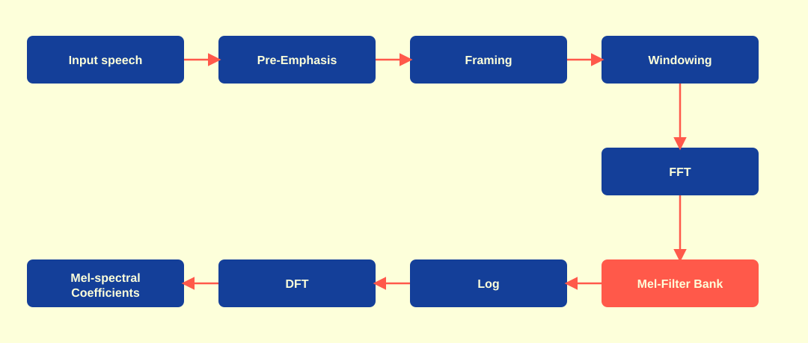
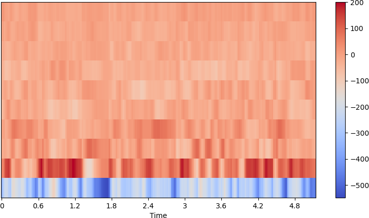
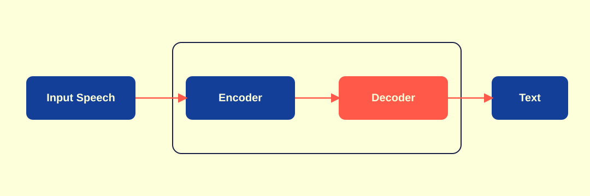
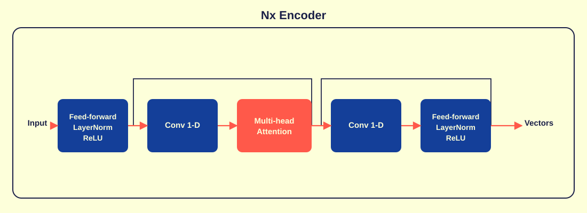
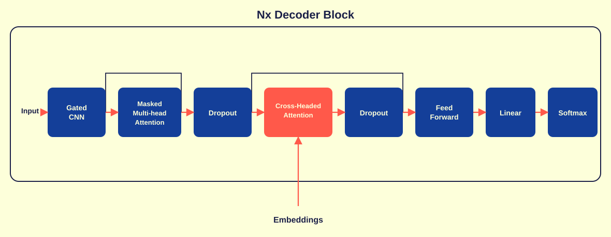

A speech model does not hear a sentence. It hears a grid. This note is about a hybrid automatic speech recognizer I worked on with Abhijeet Jadhav, Sheshank K. Patil, Satish Chikkamath, and Nirmala S. R. at KLE Technological University. The model pairs a transformer with a convolutional network so it can use both a short burst of sound and the rest of the utterance.

## What the model is given

LJ Speech is a single-speaker set of narrated nonfiction: 13,100 clips, about 24 hours in all. We held out 20% for testing and trained on the rest.

Audio goes in as Mel-frequency cepstral coefficients, not as a raw waveform. Librosa loads each file. A pre-emphasis filter lifts the high frequencies, the signal is cut into frames, and a Hamming window limits spectral leakage before the Fourier transform. A Mel filter bank then compresses the spectrum the way hearing does, and a final transform turns that into the coefficient grid. Every clip is padded to the same number of frames, so the network always sees the same shape.

The transcripts are prepared the same way a language model expects text: tokenized, filtered to a tighter vocabulary, then padded so every target sequence has one length.

## Local evidence, then the whole utterance

Recurrent models read speech one step at a time and tend to forget what happened far back. A plain transformer looks across the whole sequence at once, but it has no built-in sense of a local acoustic event, such as the burst that marks a stop consonant. The hybrid is meant to cover both.

The encoder follows a Conformer-style block. A feed-forward layer with layer normalization and a ReLU comes first. A 1D convolution, with a residual connection, picks up local patterns. Multi-head attention then relates frames that are far apart. Another convolution and another feed-forward layer close the block. Stacking that block is what carries a frame of coefficients toward a vector the decoder can read.

The decoder starts from text embeddings and a gated convolution, which filters those embeddings before attention. Masked multi-head attention keeps it from looking ahead in the transcript it is writing. Cross-attention looks back at the encoder. Dropout and residual links sit around those layers so training does not latch onto one pattern. A feed-forward layer, a linear layer, and a softmax turn the result into the next token.

## A number you can check

Training ran for 100 epochs with a batch size of 100. On the LJ Speech holdout the word error rate was **2.58%**. That is not a claim that the model understands speech. It means that, on this dataset and this split, the transcripts were close to the reference.

On the cleaner lines the output matches the reference exactly. One of them:

- Reference: Their type is on the lines of the German and French rather than of the Roman printers.
- Model: Their type is on the lines of the German and French rather than of the Roman printers.

Longer sentences still pick up a repeated word or a small substitution. The errors are local. The sentence stays recognizable.

The paper also sets 2.58% next to published word error rates from other architectures. Those figures come from their own reports, not from a rerun on LJ Speech, so they are a reference point rather than a shared leaderboard:

- Conformer (M): 2.30%
- Transformer: 2.40%
- ContextNet (M): 2.40%
- Transformer-CTC: 2.70%
- Squeezeformer-SM: 2.71%
- LAS-Transformer: 2.89%
- CitriNet 512: 3.11%
- QuartzNet: 3.90%
- This model, on LJ Speech: 2.58%

Against the Transformer-CTC figure of 2.70%, 2.58% is lower. Conformer (M), at 2.30%, is still ahead. The useful result is the balance: a hybrid of convolution and attention, trained on one speaker and about 24 hours of audio, lands in that range.

The open question is the one the dataset cannot answer. LJ Speech is one voice, in clean narration. The next measurement is what happens when the room, the microphone, or the accent changes.
